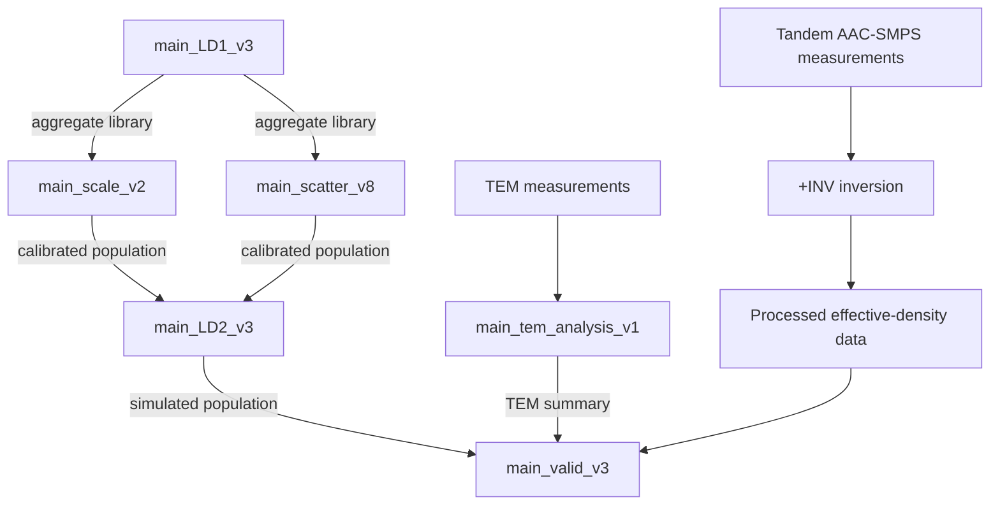

# sootMosaic

From flame-grown aggregates to hybrid soot, with Langevin dynamics and measurement comparisons.

sootMosaic was formerly named PFAL, the Post-Flame Agglomeration Algorithm.


Examples of hybrid soot imaged under transmission electron microscopy.

## What it does

- Flame-stage Langevin dynamics (LD1) generates a library of soot-like fractal aggregates.
- Scale or scatter calibration assigns aggregate and primary-particle size distributions.
- Post-flame Langevin dynamics (LD2) joins aggregates while each primary particle retains its assigned size.
- Transmission electron microscopy (TEM) analysis measures aggregate morphology and primary-particle sizes independently of the simulations.
- Validation compares LD2 populations with TEM and with effective-density measurements from a tandem aerodynamic aerosol classifier (AAC) and scanning mobility particle sizer (SMPS).
- The `+INV` package turns tandem AAC and SMPS scans into size distributions, effective density and mass.

## Workflow



Run either calibration branch before LD2. Validation reads processed measurement
files. The [inversion guide](docs/inversion.md) describes the function calls for
processing tandem scans, and the [setup guide](docs/getting_started.md#effective-density-data-and-validation)
describes the grouped density file used by the validation example.

## Quick start

1. Requirements are `MATLAB R2022a` or later, Java enabled, and `Statistics and Machine Learning Toolbox`.
2. Get the code, replacing `REPOSITORY_URL` with this repository's clone address, then open the repository root.
   ```text
   git clone REPOSITORY_URL sootMosaic
   ```
3. Create the local configuration files from the examples with the [copy commands](docs/getting_started.md#local-configuration).
4. Point each local file to its data. LD1 needs no external input. The [input table](docs/getting_started.md#local-configuration) lists the keys for subsequent stages.
5. Run the first stage and its configuration check from the repository root.
   ```matlab
   addpath(pwd)
   main_LD1_v3
   report = QA.TEST_LD1_CONFIG;
   assert(~isempty(report) && all([report.pass]))
   ```

The [full setup guide](docs/getting_started.md) covers dependencies, data,
the remaining stages, and all 38 quality-assurance (QA) checks. Main scripts clear workspace
variables and figures. Save them before running.

## The stages

### LD1 aggregate library

`main_LD1_v3` simulates flame-stage collisions and saves aggregate geometries
for calibration.

```matlab
main_LD1_v3
```

| Inputs | Outputs |
| --- | --- |
| LD1 local configuration | Aggregate library `data/main_ld1/ld1_aggregate_library.mat` |
| Physical and simulation settings | Snapshots, gas state, and configuration saved with the library |

[LD1 settings](docs/configuration.md#ld1-and-ld2-settings) control the run.
[Transport models and saved records](docs/transport_models.md) describe the physics and stored fields.

### Scale or scatter calibration

Scale applies size correlations to the library. Scatter samples size distributions.
Its mode is `bivariate` by default, or `sequential` or `ideal` through `options.opt_scale`.

Run one branch.

```matlab
main_scatter_v8
% Alternative branch
% main_scale_v2
```

| Inputs | Outputs |
| --- | --- |
| LD1 aggregate library and calibration settings | Calibrated population for LD2 |
| Scatter branch | `data/main_scatter/scaled_aggs_for_LD2_from_main_scatter.mat` |
| Scale branch | `data/main_scale/scaled_aggs_for_LD2_from_main_scale.mat` |

[Calibration settings](docs/configuration.md#scale-and-scatter-settings) specify
distributions, correlations, sampling, and projection. Figures go to the matching
`results/main_scatter/` or `results/main_scale/` folder.

### LD2 post-flame agglomeration

`main_LD2_v3` simulates collisions between calibrated aggregates after the flame.
Primary-particle sizes stay fixed as hybrid aggregates form.

```matlab
setenv('SOOTMOSAIC_MAIN_LD2_CONFIG', ...
    'config/main_ld2/main_ld2_from_main_scatter_config.local.json')
main_LD2_v3
```

| Inputs | Outputs |
| --- | --- |
| Calibrated population from the matching branch and the LD2 branch configuration | Checkpoints and a final MAT workspace |
| Scatter branch | `results/main_ld2_from_main_scatter/` |
| Scale branch | `results/main_ld2_from_main_scale/` |

For scale, select `config/main_ld2/main_ld2_from_main_scale_config.local.json`.
[LD2 settings](docs/configuration.md#ld1-and-ld2-settings) control transport and
saved fractions. [First runs](docs/getting_started.md#ld2-and-checkpoints)
explains checkpoint resume and final filenames.

### TEM analysis

`main_tem_analysis_v1` analyzes aggregate measurements and primary-particle areas.
It produces morphology summaries, model-input statistics, and figures.

```matlab
main_tem_analysis_v1
```

| Inputs | Outputs |
| --- | --- |
| Aggregate MAT files and primary-area CSVs in configured entry folders | `data/main_tem_analysis/tem_analysis_results.mat` |
| TEM local configuration | Summary CSVs and `results/main_tem_analysis/` figures |

[TEM settings](docs/configuration.md#tem-inputs-and-figures) define entry IDs,
analysis, and figures. The [data guide](docs/getting_started.md#tem-analysis)
lists the expected measurement fields and units.

### Validation

`main_valid_v3` compares LD2 populations with processed TEM and tandem effective
density. It produces diameter and density comparisons with pointwise predictions
and log-space metrics.

```matlab
main_valid_v3
```

| Inputs | Outputs |
| --- | --- |
| Final LD2, processed TEM, and effective-density MAT files | `validation_dpp_vs_da` and `validation_rho_eff_vs_dm` PDF/PNG pairs |
| Condition mappings and validation settings | `results/main_valid/runs/<timestamp>/` records and `validation_results.mat` |

[Validation settings](docs/configuration.md#validation-settings-and-figures)
control condition mappings, fits, reference relations, and exports.

## Inversion of tandem data

- Readers load SMPS exports, SMPS database records and AAC scans together with their recorded flows, pressure and temperature.
- Forward models of the classifiers, particle charging, tube losses and counter efficiency turn each scan into a matrix problem.
- Regularized solvers recover the size distribution of each scan. Separate functions give its posterior covariance and fit lognormal peaks.
- Density calibration, mass integration and group averaging give effective density and mass concentration with intervals.

The [inversion guide](docs/inversion.md) covers configuration, call order,
and the function reference for `+INV`.

## Soot as a mosaic

In a flame, primary particles can have nearly uniform size within an aggregate,
while that size differs between aggregates. As soot dilutes and cools downstream,
collisions join aggregates of different primary size into hybrid structures.
Each parent remains a patch of its own primary size, giving the hybrid a mosaic appearance.

## How the Langevin dynamics loop works

1. Read physical, domain, transport, and output parameters.
2. Initialize primary-particle sizes and aggregate morphology.
3. Assign random particle locations and velocities.
4. Compute mobility and Brownian transport properties.
5. March positions and velocities under Brownian motion, drag, and inertia.
6. Apply periodic boundary conditions.
7. Detect collisions and connect touching aggregates.
8. Update geometry, mobility, and saved diagnostics.

## Repository map

| Folder or file | Contents |
| --- | --- |
| `main_LD1_v3.m`, `main_scale_v2.m`, `main_scatter_v8.m`, `main_LD2_v3.m` | Simulation and calibration stages |
| `main_tem_analysis_v1.m`, `main_valid_v3.m` | Measurement analysis and validation |
| Other `main_*` and `post_*` scripts | Shielding, collapse, and post-processing using configured `post` inputs |
| `config/` | Task examples, model profiles, and dataset and instrument registries |
| `docs/` | Setup, configuration, transport, and inversion guides |
| `data/`, `results/` | Measured inputs, stage products, workspaces, figures, and validation records |
| `inputs/` | Tab-delimited parameter files |
| `+INV/` | Instrument import and inversion functions |
| `+PAR/`, `+COL/` | Particle initialization, sizing, projection, geometry, collisions, and aggregate growth |
| `+TRANSP/` | Transport properties, mobility, marching, and boundaries |
| `+UTILS/` | Configuration, data loading, checkpoint resume, fitting, and plotting |
| `+VIS/`, `@AGG/` | Visualization routines and aggregate class |
| `+QA/` | Synthetic tests and aggregate geometry checks |
| `THIRD_PARTY_NOTICES.md` | Source, license, and method notices for adapted code and the progress bar |

Detailed [configuration files](docs/configuration.md#configuration-files),
[inversion functions](docs/inversion.md#function-reference), and
[saved-record helpers](docs/transport_models.md#saved-products-and-source-records)
are listed in the guides.

## Citing

Cite reference 6 for the post-flame agglomeration method and the relevant
method references below for transport and measurement analysis.
Record the code revision and model profile with reported simulations.

## References

1. Suresh, V., & Gopalakrishnan, R. (2021). Tutorial: Langevin Dynamics methods for aerosol particle trajectory simulations and collision rate constant modeling. Journal of Aerosol Science, 155, 105746.
2. Heine, M. C., & Pratsinis, S. E. (2007). Brownian coagulation at high concentration. Langmuir, 23(19), 9882-9890.
3. Brasil, A. M., Farias, T. L., & Carvalho, M. G. (1999). A recipe for image characterization of fractal-like aggregates. Journal of Aerosol Science, 30(10), 1379-1389.
4. Olfert, J., & Rogak, S. (2019). Universal relations between soot effective density and primary particle size for common combustion sources. Aerosol Science and Technology, 53(5), 485-492.
5. Baldelli, A., Trivanovic, U., Corbin, J. C., Lobo, P., Gagne, S., Mille, J. W., and Rogak, S. (2020). Typical and atypical morphology of non-volatile particles from a diesel and natural gas marine engine. Aerosol and Air Quality Research, 20(4), 730-740.
6. Nikookar, H., Sipkens, T. A., & Rogak, S. N. (2025). Simulating the effect of post-flame agglomeration on the structure of soot. Aerosol Science and Technology, 59(1), 1-15.
7. Kim, J. H., Mulholland, G. W., Kukuck, S. R., & Pui, D. Y. H. (2005). Slip correction measurements of certified PSL nanoparticles using a nanometer differential mobility analyzer (nano-DMA) for Knudsen number from 0.5 to 83. Journal of Research of the National Institute of Standards and Technology, 110(1), 31-54.
8. Sorensen, C. M. (2011). The mobility of fractal aggregates: A review. Aerosol Science and Technology, 45(7), 765-779.
9. Rogak, S. N., Flagan, R. C., & Nguyen, H. V. (1993). The mobility and structure of aerosol agglomerates. Aerosol Science and Technology, 18(1), 25-47.
10. Thajudeen, T., Gopalakrishnan, R., & Hogan, C. J., Jr. (2012). The collision rate of nonspherical particles and aggregates for all diffusive Knudsen numbers. Aerosol Science and Technology, 46(11), 1174-1186.
11. Moran, J., Yon, J., Poux, A., Corbin, F., Ouf, F.-X., & Simeon, A. (2020). Monte Carlo Aggregation Code (MCAC) Part 2: Application to soot agglomeration, highlighting the importance of primary particles. Journal of Colloid and Interface Science, 575, 274-285.
12. Eggersdorfer, M. L., & Pratsinis, S. E. (2014). Agglomerates and aggregates of nanoparticles made in the gas phase. Advanced Powder Technology, 25(1), 71-90.
13. Kiasadegh, M., Sipkens, T. A., Symonds, J. P. R., & Olfert, J. S. (2026). Practical considerations for measuring effective density: Operational tradeoffs in resolution, characteristic scan time, and calibration. Aerosol Science and Technology, 60(7), 695-714. DOI 10.1080/02786826.2026.2659050.
14. tandem (software), release v2.0.0. https://github.com/cambustion/tandem.
15. Sapkota, N., Sipkens, T. A., & Rogak, S. N. (2025). Charging equivalent diameter relation for sodium chloride and soot aggregates using electrical low-pressure impactor. Aerosol Science and Technology, 59(9), 1053-1064. DOI 10.1080/02786826.2025.2519093.
16. Kiasadegh, M. (2025). ACORC: Aerosol Classifier Operational Range Calculator (DMA, AAC, CPMA). Zenodo. DOI 10.5281/zenodo.15620940.
